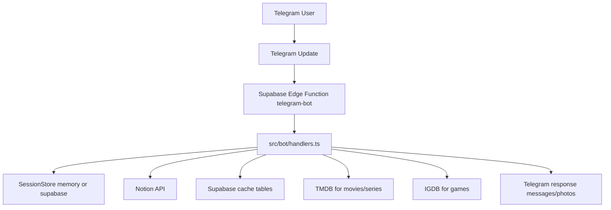

# PopcornPal Architecture

## WHO

This document is for engineers implementing or changing the Telegram bot behavior.

## WHAT

This document describes how PopcornPal processes Telegram updates, picks movie/series/game candidates from Notion, enriches metadata with TMDB or IGDB, and persists session/cache state via Supabase.

## WHEN

- Created: 2026-07-28
- Last reviewed: 2026-07-28
- Last updated: 2026-07-28

## WHY

The bot combines five external systems (Telegram, Supabase Edge Functions, Notion, TMDB, IGDB), and production issues usually happen at integration boundaries rather than in local business logic.

After reading this document, you should understand the end-to-end request path, where state is stored, why dual-runtime abstractions exist, and which operational constraints are non-negotiable for reliable webhook handling.

Key constraints and trade-offs:

- One codebase serves two runtimes: Deno (production webhook) and Node/Bun (local tooling/polling), so environment access and handler interfaces are runtime-agnostic.
- Session state and recommendation caches always use Supabase so chat workflows and language preferences survive restarts in every runtime.
- Bot interface strings use i18next with English fallback; TMDB receives the chat locale and provider caches are locale-specific. IGDB content and user-authored Notion text remain as supplied because neither is automatically translated.
- Recommendation freshness favors correctness over stale speed: after rating updates in Notion, related cache entries are deleted and re-fetched on next request.

## HOW

### Beginning: Runtime Shape, Entry Points, and Invariants

Production entry point is `supabase/functions/telegram-bot/index.ts`. It runs in Deno, wires `grammy` webhook handlers, validates Telegram secret token when `SUPA_FUNCTION_SECRET` is set, and exposes a GET health response plus POST webhook processing.

Local/legacy Node entry is `src/index.ts` with `src/services/bot.ts` polling. Production does not use polling, but both runtime paths call the same handler module (`src/bot/handlers.ts`) through the shared `BotMessenger` interface.

Critical invariants:

- Environment variables are accessed only through `getEnvVar()` in `src/runtime/env.ts`.
- `SUPA_FUNCTION_SECRET` must contain only `A-Z`, `a-z`, `0-9`, `_`, `-` for Telegram webhook auth compatibility.
- Local webhook development uses `supabase functions serve telegram-bot --no-verify-jwt --env-file supabase/functions/.env.local`.

### Middle: End-to-End Behavior and Component Responsibilities

#### Component Map

- Telegram transport:
  - Webhook mode: `grammy` in Deno Edge Function.
  - Polling mode: `node-telegram-bot-api` in Node/Bun.
- Conversation orchestration:
  - `src/bot/handlers.ts` manages commands, text, callbacks, state transitions, and message rendering.
- Session state abstraction:
  - `src/bot/session-store.ts` defines typed steps.
  - `src/bot/session-store.supabase.ts` persists workflow state and language preferences in `public.bot_sessions`.
- Content source and updates:
  - `src/services/notion.ts` queries random candidates and writes final ratings/status to Notion pages.
- Enrichment services:
  - `src/services/tmdb.ts` resolves movie/series candidates and details.
  - `src/services/igdb.ts` resolves game details with Twitch OAuth token caching.
- Cache and persistent data:
  - `src/services/db.ts` reads/writes `movies`, `series`, `games` cache and supports cache invalidation.

#### Primary Flows

Movie flow:

1. User selects `Find a Movie`.
2. Bot resets session and picks a random Notion page (`Status` in `Backlog` or `Plan to watch`).
3. Bot checks `public.movies` cache by `notion_title`.
4. On cache miss, bot queries TMDB search + details, limits to top 5 candidates, saves them in cache.
5. Bot sends one or more candidate cards with `Watched` callback.
6. `watched_<pageId>_<index>` callback transitions to `AWAITING_RATING`.
7. Rating 1-5 updates Notion (`Status=Watched`, `Rating`, `Genre`) and invalidates related movie/series cache rows.

Series flow is equivalent to movie flow but uses Notion series DB and `public.series` plus TMDB TV endpoints.

Game flow:

1. User selects `Find a Game`.
2. Bot prompts for platform (`Playstation` or `PC`) and style (`Story-driven` or `Gameplay-driven`).
3. Bot queries Notion games DB with status, style, and platform filters.
4. Bot checks `public.games` cache by `notion_title`; on miss, it queries IGDB with ranked best-match selection.
5. Bot sends game card with `Played` callback.
6. `played_game_<pageId>` callback transitions to `AWAITING_GAME_RATING`.
7. Rating 1-5 updates Notion (`Status=Finished`, `Rating`, `Genre`) and invalidates related game cache rows.

#### Session Model

Session states in `SessionStep`:

- `VIEWING_OPTIONS`
- `VIEWING_GAME`
- `AWAITING_RATING`
- `AWAITING_GAME_PLATFORM`
- `AWAITING_GAME_TYPE`
- `AWAITING_GAME_RATING`

Behavioral notes:

- `<< back` returns from game type to platform, or resets to main action for other states.
- Expired state data (missing `pageId`/`notionTitle`) causes graceful reset with user guidance.
- Callback handlers recover missing session context by resolving Notion page title and cache rows.

#### Persistence Model

Supabase tables and purpose:

- `public.bot_sessions`: persistent workflow state and per-chat language preference.
- `public.movies`: movie candidate cache keyed by `notion_title` and language.
- `public.series`: series candidate cache keyed by `notion_title` and language.
- `public.games`: game cache keyed by `notion_title` and language.

Migration sequence currently in repository:

1. `20260422000100_create_bot_sessions.sql`
2. `20260423000100_create_movies_table.sql`
3. `20260423164703_alter_movies_genres_to_text_array.sql`
4. `20260504000100_create_games_table.sql`
5. `20260504000200_extend_bot_sessions_for_games.sql`
6. `20260514000100_create_series_table.sql`

#### Security and Operational Controls

- Webhook authenticity is enforced with Telegram secret token support in `webhookCallback(..., { secretToken })`.
- Production deploy and webhook registration use:
  - `bun run deploy:webhook`
  - `bun run set:webhook`
- Local runtime must be restarted after `.env.local` changes so function env values reload.

#### Failure Modes and Recovery

- Notion no-result: bot returns an explicit not-found message for selected content type.
- TMDB/IGDB miss: bot reports missing details and keeps chat usable.
- Supabase read/write errors: logged to runtime; cache falls back to external API fetch where possible.
- Invalid rating input: bot rejects values outside 1-5 and keeps state for retry.

Trade-offs accepted:

- Duplicate external API calls can still happen under concurrent requests before cache fill; this is tolerated to keep logic simple.
- Cache invalidation is coarse (`delete by notion_title`) but ensures stale enrichment data is removed after rating updates.

### End: Practical Takeaways, Limits, and Next Actions

PopcornPal is a handler-centric architecture where Telegram transport is replaceable, business logic is centralized, and state concerns are separated into session state (conversation progress) and cache state (content enrichment reuse).

This design is intentionally pragmatic: it minimizes framework coupling and supports both Deno webhook production and Node/Bun local workflows with shared domain logic.

Current limits to track:

- No explicit cache TTL or eviction policy; cache lifecycle is event-driven by user rating updates.
- Some user-facing text in code currently differs from Ukrainian-only convention documented in project rules.

Recommended next architecture steps:

1. Add explicit cache freshness policy (TTL or periodic cleanup) for `movies`, `series`, and `games`.
2. Align all user-facing strings with the chosen language convention and freeze button labels as typed constants.
3. Add structured telemetry around external API failures and callback/rating conversion funnel.
